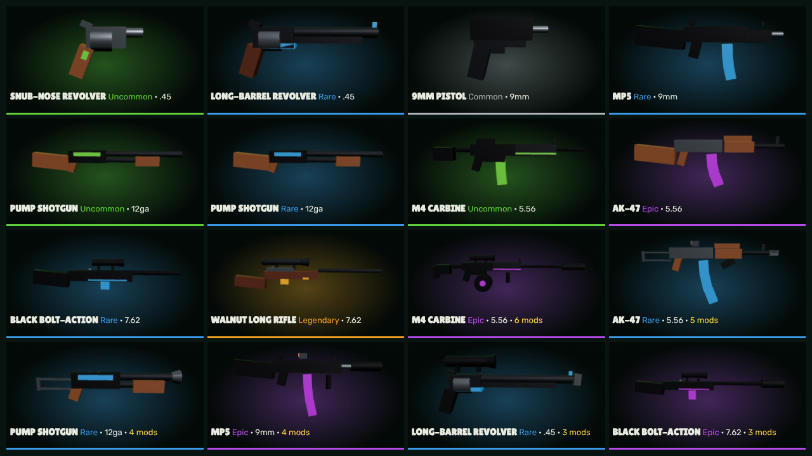
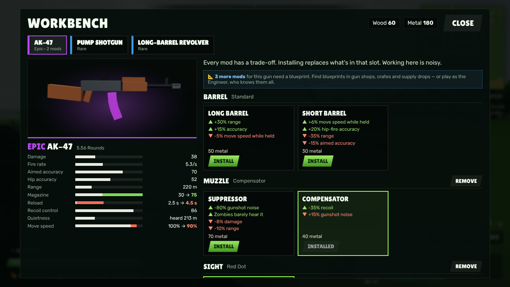
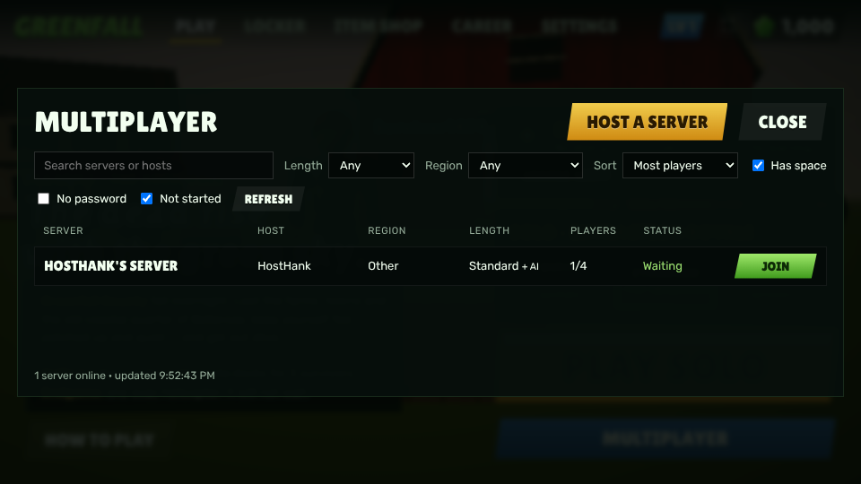

# Greenfall

**A free zombie extraction battle royale for the browser.**

You wake up somewhere in the farm country of Greenfall County with a few supplies, the
skills of your class and nothing but your bare hands, alone or with friends. Loot the farms, towns and an old coastal quarter, keep yourself fed,
watered and patched up, find a bike or a truck, and get off the island alive. You can't
outrun the dead forever. Instead of a storm, **hordes** close in: green zones where zombies
claw up out of the ground nonstop. They swell when they hear gunfire or spot you, drift
toward noise, and big ones can migrate fast.

There are two ways out:

* **The riverboat *Magnolia*** docks halfway through the match at one of three piers and
  takes the first **3** survivors to board.
* **The evac helicopter** lands when only a few survivors are left. It waits for a short
  time and then leaves without whoever didn't make it. If you eliminate every other survivor
  while it is inbound, it comes to pick you up.


| | |
|---|---|
|  |  |
|  |  |
|  |  |
|  |  |
|  |  |
|  |  |

## Play it locally

```bash
cd greenfall
npm install
npm run dev        # http://localhost:5173
```

You'll need a browser with WebGL 2 (any recent Chrome, Edge, Firefox or Safari). Phones and
tablets get touch controls automatically (see [Mobile](#mobile)).

To get a single file you can double-click to play (no server, works offline):

```bash
npm run package:single        # writes release/greenfall.html (~1.1 MB)
```

Useful URL flags while testing: `?q=low|medium|high|ultra` forces a graphics preset and
`?autoplay=quick` jumps straight into a match.

## Publish on itch.io (free)

```bash
npm run package:itch          # builds and writes release/greenfall-web.zip (~0.5 MB)
```

On itch.io: **Create new project** → **Kind of project: HTML** → upload
`release/greenfall-web.zip` → tick **This file will be played in the browser**. Recommended
embed options:

* Viewport: **1280 × 720**, with **Mobile friendly** and **Fullscreen button** turned on
  (orientation: **landscape**).
* Leave **SharedArrayBuffer support** off. It isn't needed.
* Pricing: **No payments** or **Donate** for a free game.

The build uses relative paths (`base: './'`), so it works inside itch's iframe. Everything
(textures, models, audio, music) is generated in code, so there are no asset files to host.

To sell Shards later, you also need the small wallet server. See
[Currency and selling Shards](#currency-and-selling-shards).

## Controls

| Action | Keyboard / mouse |
|---|---|
| Move / sprint / crouch (quiet) | W A S D · Shift · C or Ctrl |
| Jump · vault through a window | Space |
| Fire / use item · aim | Left mouse · Right mouse |
| Reload · interact (hold to board up, search) | R · E |
| Bare hands / hotbar | 1 – 6, mouse wheel |
| Holding a Mason's Trowel: lay bricks · wall ↔ wall with window | Left mouse · R |
| Quick heal · quick eat/drink | H · X |
| Inventory & crafting · map · flashlight | Tab · M · L |
| Drop held item · emote · pause | T · B · Esc / P |

**Driving:** E gets on or off. W/S are throttle and brake/reverse, A/D steer, Space is the
handbrake, H honks the horn and L turns the headlights on and off. The camera follows behind
you; move the mouse to look around.

**Melee and gathering:** you start with bare hands, which can only punch. Find a **Fire
Axe**, **Pickaxe** or **Machete** to chop trees, break rocks, strip cars for metal and smash
doors, boards and brick walls.

**Workbenches:** walk up to one and press E. Revolvers fire faster from the hip than when
aiming (right mouse).

## What's in the game

### The island

A hand-built layout taken from the concept map:

* **Millbrook**: a small town with rural residential lanes (NW)
* **Route 9 Plaza**: the retail strip (gas station, MegaMart, motel, diner, stores)
* **Hollow Creek**: farms and the main country area, with red barns, silos, corn and wheat,
  pastures, an orchard, a horse ranch and the grain co-op
* **Cedar Ridge**: big open country in the middle, with Lake Wren, the sawmill, the county
  fairgrounds and Ferris wheel, Lookout Hill radio tower, the old quarry and Bayou Bend
* **Pelican Harbor**: a deep bay with cranes, warehouses, containers and a lighthouse
* **Bellerose**: an old coastal quarter with wrought-iron balconies, a cathedral square,
  St. Agnes Cemetery and the riverboat wharf
* Open ocean to the east, reserved for the future ocean update

The island is about 3.6 × 2.7 km of land with roughly 1,700 enterable buildings. Every house
has rooms, stairs, furniture, doors and windows, and things to search. The map is streamed in
chunks with LODs, so you can see across the whole county from a hilltop.

### Random spawns

There's no drop. Each survivor wakes up next to a random home, weighted toward the country
side:

| Area | Share of spawns |
|---|---|
| Hollow Creek farms | ~38% |
| Millbrook (town) | ~25% |
| Cedar Ridge (country) | ~23% |
| Redbarn Farm | ~8% |
| Route 9 Plaza | ~6% |

**Nobody spawns in Pelican Harbor or Bellerose.** You have to travel there for the loot.
The first few rivals spawn at least 420 m from you, so the first minutes are for looting,
not fighting.

### Classes

Pick a class from the **Play** tab before a match. Every class is built from the same point
budget: **each bonus is paid for with a drawback of the same size**. Strong bonuses come with
strong drawbacks, small bonuses with small ones. The class card shows this as two bars that
always match (`src/data/classes.js` checks the budget; every class is within ±4%).

| Class | Good at | Pays for it with | Starts with |
|---|---|---|---|
| **Survivor** | Nothing special | Nothing | Water bottle |
| **Mechanic** | +100% vehicle repair, −35% fuel use, can fix vehicles with 20 metal | −30% healing from meds, −12% gun damage, −30% stamina, −12% accuracy | Repair kit, gas can |
| **Medic** | +40% healing from meds, +40% healing speed, +45% infection resistance, bandages slow infection | −25% gun damage, −20% reload speed, −25% melee damage | Medkit, 3 bandages |
| **Carpenter** | +60% barricade strength, +60% bricklaying and board-up speed, −30% brick wall cost, +30% materials | −15% gun damage, −20% accuracy, −30% stamina, −20% reload speed | Mason's Trowel, 50 wood, 30 stone |
| **Soldier** | +15% gun damage, +20% accuracy, +25% reload speed | +35% hunger and thirst, +25% noise, −20% healing from meds | 9mm Pistol, 30 rounds |
| **Scout** | +8% move speed, +50% stamina, −25% noise | −25% max health, −10% gun damage, −2 backpack slots | Energy drink |
| **Farmer** | −35% hunger and thirst, raw food and dirty water are safe, +30% materials | −15% gun damage, −15% accuracy, −20% reload speed | 3 apples, campfire kit |
| **Hunter** | +30% accuracy, −20% noise, +5% gun damage | −15% max health, −30% healing from meds, −20% melee damage | Crossbow, 8 bolts |
| **Engineer** | Knows every gun mod blueprint, −40% gun mod cost, +10% reload speed | −15% max health, −30% stamina, −15% melee damage | 60 metal |
| **Scavenger** | +100% search speed, +30% extra loot, +2 backpack slots | −20% max health, −10% gun damage, −30% stamina, −15% melee damage | 3 cloth, chips |

AI survivors pick random classes too, and the same rules apply to them.

To tune a class, edit its `mods` in `src/data/classes.js`. The weights in `STATS` say how many
budget points 1% of each stat is worth (move speed and gun damage are expensive, search speed
is cheap). Run `npm run check:classes` to check the budget.

### Vehicles

Dirt bikes and pickup trucks are parked at farmhouses, barns, gas stations, motels and some
homes (about 90 per match). They're simple but grounded:

* **Fuel.** Most are part full, some are empty. A full tank lasts about 3 km on a bike or
  6 km in a truck. Refill from a **gas can** (loot from gas stations, garages and sheds), or
  **siphon** an abandoned car for gas (sometimes you get a can out of it too).
* **Condition.** Crashes, zombies and bullets wear vehicles down. Under half condition they
  lose top speed, under 40% they smoke, below 15% the engine won't start, and at 0 they
  catch fire and explode. Fix them with a **repair kit**, or as a Mechanic, with 20 metal.
* **Using items:** hold the gas can or repair kit and click the vehicle, or open the
  inventory and choose **Use on vehicle** when you're next to one.
* **Terrain:** fastest on roads, slower on grass, slowest in forest and corn. Deep water
  floods the engine.
* **Noise.** Engines are loud and draw zombies, and the horn is louder still. A bike is
  faster and quieter. A truck is tougher and protects you from bites (zombies hit the truck
  instead).
* Hitting zombies at speed knocks them down, but it damages the vehicle. Crash a bike hard and
  you go over the handlebars.

### Survival

* Hunger, thirst and stamina all drain.
* Bleeding needs a bandage, a fractured leg needs a splint (painkillers dull it), and an
  infection from a bite needs antibiotics.
* Raw meat and dirty water can give you food poisoning. Cook them at a campfire.
* Hunt deer, chickens and cows for meat, fill bottles at the lake and ponds, and craft
  bandages, splints, campfires and armor plates.

### The dead

* Instanced zombies (walkers, fast runners at night, brutes) that see and hear you. They hit
  harder as the match goes on.
* They bash doors, barricades and your builds, climb through windows and follow building
  layouts to reach you.
* Every action makes noise: footsteps, doors, hammering, gunfire (suppressed weapons are
  quiet), engines. Shooting a car can trip its alarm. An alarm clock lures the dead away.

### Guns

Five calibers, two or three guns each. Each gun only spawns in the rarities listed; higher
rarities hit harder and reload faster.

| Gun | Ammo | Rarity | Mag | What it's for |
|---|---|---|---|---|
| **Snub-Nose Revolver** | .45 | Uncommon | 8 | Fast and inaccurate. Fires 4.8 shots/s from the hip, 3/s aimed |
| **Long-Barrel Revolver** | .45 | Rare | 6 | Heavy hits (62) at a steady pace. 2.4 shots/s from the hip, 1.5/s aimed |
| **9mm Pistol** | 9mm | Common–Rare | 15 | Small, light, quick |
| **MP5** | 9mm | Uncommon–Epic | 30 | Full auto, 12 rounds/s, weak at range |
| **Pump Shotgun** | 12 gauge | Uncommon, Rare | 5 | 9 pellets, about 110 damage point-blank |
| **M4 Carbine** | 5.56 | Common–Legendary | 30 | Accurate, controllable full auto |
| **AK-47** | 5.56 | Uncommon–Legendary | 30 | Hits harder than the M4, kicks more |
| **Black Bolt-Action** | 7.62 | Rare, Epic | 5 | Compact sniper with a quick bolt and a 2× scope |
| **Walnut Long Rifle** | 7.62 | Rare–Legendary | 4 | Wood-stock heavy rifle with a long scope and bullet drop |

The silent crossbow and the machete are still in the game, plus frags, molotovs and alarm
clocks. AI survivors carry the same guns, and better-geared ones may already have a mod or
two.

### Workbenches and gun mods

About 40 **weapon workbenches** (an orange wrench square on the map and minimap) stand in
every gun shop, pawn shop, sheriff's office and hardware store, and in some barns, garages,
gas stations and warehouses. At a bench you can fit one mod per slot: **barrel, muzzle,
sight, stock, grip and magazine**. Mods cost metal (and some wood), show up on the gun, and
stay on it if you drop it or die. Working at a bench makes noise.

Every mod has a trade-off, shown as ▲/▼ lines. Hover a mod to preview how it changes the
gun's stats.

| Slot | Basic mods (anyone) | Advanced mods (blueprint needed) |
|---|---|---|
| Barrel | Long Barrel, Short Barrel, Sawed-Off (pump) | Extended Barrel |
| Muzzle | Compensator | Suppressor, Full Choke and Spreader Choke (pump) |
| Sight | Red Dot | 4× Scope |
| Stock | Padded Stock, Folding Stock | — |
| Grip | Vertical Grip, Rubber Grip (handguns) | Angled Grip |
| Magazine | Extended Mag, Speed Loader (revolvers), Side Saddle (pump) | Drum Mag, Tube Extension (pump) |

**Blueprints:** advanced mods don't appear at the bench until you can build them. The
**Engineer** class knows every blueprint and pays 40% less for mods. Every other class can
unlock advanced mods one by one with **blueprints**: blue rolled-up sheets found in gun shops,
hardware stores, toolboxes and crates. Every supply crate has one, and airdrops have two.
Walk over a blueprint and press E to learn it for the rest of the match. It doesn't take a
slot. When a gun still has locked mods, the bench says how many; Tab shows the blueprints you
know.

### Materials, melee tools and brick walls

There's no free-form building. You still gather **wood, stone and metal**, but only with a
melee tool you find. Each tool is better at some things:

| Tool | Best at | Smashing doors, boards and walls |
|---|---|---|
| **Fire Axe** | Wood (trees, fences) | Strongest |
| **Pickaxe** | Stone (rocks) and metal (cars) | Strong |
| **Machete** | Fighting the dead; some wood | Weak |
| Bare hands | Nothing | Barely |

Materials go into barricades (wood), crafting (bandages, splints, campfires, armor), gun mods
(metal and wood) and vehicle repair (metal, for the Mechanic).

**Brick walls** are the one thing you can build, and only in a special case: you need a
**Mason's Trowel** (found in hardware stores, sheds and toolboxes; the Carpenter starts with
one).
* Hold the trowel to see where a wall would go: on the ground where you stand, on the edge of
  the 4 m grid you're facing.
* Click to lay it. **R** switches between a plain wall (30 stone) and a wall with a window
  you can see and shoot through (25 stone).
* Walls take a few seconds to set and the bricklaying is loud.
* No floors, ramps, roofs or stacking.
* Guns, explosives and melee tools break walls; an axe needs about 5 hits.

### Rivals

29–59 AI survivors with original cosmetics. When they're far away they're simulated cheaply,
so the match pace stays right. Near you they're fully physical: they loot, fight with
human-like aim error, dodge when shot, heal, fight the dead with whatever melee tool they
found, flee hordes and race you to the extraction.

### Day and night

* Misty mornings, bright stylized days and orange sunsets.
* At dusk the sky turns sickly green and the storm rolls in. Nights bring rain and lightning,
  faster zombies, warm porch and gas-lamp lights, and a flashlight that makes you easier to
  spot. Vehicles have headlights.

### Match lengths

| Preset | Length | Survivors |
|---|---|---|
| Quick | ~25 min | 30 |
| Standard | ~1 hr | 50 |
| Marathon | 2–3 hr | 60 |

You can pause a solo match at any time. Multiplayer matches keep running when you open the
menu.

### Meta

* Shards (the in-game currency), XP and levels, career stats and match history.
* An **item shop** in the OG layout:
  * Two **Featured** outfits (at least one Epic or Legendary) and six **Daily** items, all
    rotating at 00:00 UTC.
  * Nothing from yesterday's shop comes straight back. Cards say **NEW!** or how many days
    ago an item was last in the shop.
  * Clicking an item shows a slowly turning 3D preview.
* **The shop is the same for every player.** The rotation is computed from the UTC day, and
  the game syncs its clock to the Greenfall server (or the page host's clock on itch.io), so
  a wrong PC clock doesn't show a different shop. The wallet server uses the same rotation
  when it checks purchases.
* A **locker** for outfits, back blings, **bike paints**, emotes and weapon wraps. The old
  harvesting tool skins were retired along with the starting pickaxe. Anyone who bought one
  automatically gets its price back in Shards.
* All 20 outfits and every item are original designs. The characters use stylized
  proportions (bigger heads, broader shoulders, solid limbs). Hoods, helmets and masks show
  the face, and plain shirts stay plain.

## Mobile

The game runs in mobile browsers (tested with iPhone and Android emulation in Chromium; try
it on your own phone before launch):

* The lobby, shop, locker and class picker all have portrait layouts.
* Matches are played in **landscape**. In portrait, the game shows a "turn your phone
  sideways" screen. Starting a match on a phone goes fullscreen where the browser allows it.
  Android Chrome does. iPhone Safari doesn't let web pages go fullscreen, so on iPhone the
  game plays with the browser bars visible.
* Touch controls: a move stick on the left, drag anywhere on the right to look, and buttons
  for fire, aim, jump, crouch, reload, use, heal and eat.
  * On a vehicle the buttons change to **BRAKE / EXIT / HORN** and the combat buttons hide.
  * With a trowel they change to **LAY / WINDOW**.
* Phones and tablets start on the **Low** graphics preset. Players can raise it in Settings.

## Multiplayer

Press **Multiplayer** on the Play tab. You get a **server list**:

* **Search** by server or host name.
* **Filter** by match length, region, *has space*, *no password* and *not started*.
* **Sort** by most or fewest players, newest, or name.
* The list refreshes every 5 seconds, and your filters are remembered.

**Host a server** to make your own:
* Name it and pick the match length.
* Choose 2–8 players and a region.
* Add an optional password.
* Choose whether AI survivors fill the rest of the island.

Players gather in the room lobby (the host can kick), and the host presses **Start match**.

How it works:
* The **host's game runs the shared world**: zombies, hordes, AI survivors, the riverboat
  and helicopter, and airdrops. Everyone else's game mirrors it.
* **Each player's own game runs their own movement**, and reports shots and hits. Hits on
  other players, AI survivors and zombies are sent to whoever is in charge of them.
* Loot taken or dropped, doors, barricades, searched containers, supply crates, brick walls
  and the vehicles people drive are shared.
* **House loot is rolled from the match seed**, so every player generates the same items
  without sending them.
* **Extraction seats are decided by the host.** The riverboat's 3 seats really are 3 for
  everyone.
* Matches can't be joined once they've started. If the host leaves, the match ends for
  everyone. If a player leaves, the others are told.

**Running it:** multiplayer uses the same zero-dependency Node server as the wallet.
`server/server.mjs` serves both, or run `server/relay.mjs` alone for just multiplayer. The
server only lists rooms and passes messages; the game logic runs in the host's browser.

```bash
PORT=8787 ALLOWED_ORIGINS=https://html-classic.itch.zone,https://YOURNAME.itch.io node server/server.mjs
VITE_GREENFALL_API=https://your-server.example.com npm run package:itch
```

In development (`npm run dev` on localhost), the game looks for the server on
`http://localhost:8787`, so `npm run server` in a second terminal is all you need. Set
`VITE_GREENFALL_MP` instead of `VITE_GREENFALL_API` to use a separate relay host.

Limits to know:
* The host's connection and PC carry the match. Trust is client-side: a player's game reports
  its own hits, which is fine for friends but not cheat-proof.
* Up to 8 players per server.

## Currency and selling Shards

**Short version:** the game works today without a server, and Shards are earned only by
playing. Before you sell Shards for real money, you need to run the wallet server in
`server/`, because anything stored only in the browser can be edited by players.

### Offline mode (default, no server)

* Shards, owned items and XP live in `localStorage`. Rewards come from one shared formula
  (`src/data/rewards.js`) with caps per match length.
* The save is **signed**. If someone edits their Shards in the browser's dev tools, the
  signature stops matching, the balance resets to 0, and the game shows a notice. This stops
  casual cheating, but a determined player can still get around it, because the code runs on
  their computer. That's fine for free Shards. It isn't safe for paid ones.

### Online mode (`server/server.mjs`)

A small, dependency-free Node server becomes the source of truth for Shards, owned cosmetics
and match rewards:

* Every purchase is checked on the server (enough Shards, and the item is in today's shop).
* Match rewards are capped by **real elapsed time**. The client has to start a match on the
  server and end it later, so you can't claim a 45-minute extraction after 2 minutes, claim
  more kills than time allows, or replay an old match.
* Players get an anonymous account token on first launch. Their old offline Shards are not
  carried over, which keeps edited saves out.
* If the server is unreachable, the game falls back to offline mode and keeps working.

**Setup:**

1. Host the server anywhere that runs Node 18+, for example Fly.io, Render, Railway or a
   small VPS. It stores everything in one JSON file, so give it a persistent disk.

   ```bash
   PORT=8787 DB_FILE=/data/greenfall-db.json \
   ALLOWED_ORIGINS=https://html-classic.itch.zone,https://YOURNAME.itch.io \
   node server/server.mjs
   ```

   Put it behind HTTPS. Most hosts do this for you, and itch.io pages are HTTPS, so browsers
   block plain-HTTP calls from them.

2. Build the game pointed at the server and upload the new zip to itch.io:

   ```bash
   VITE_GREENFALL_API=https://your-server.example.com npm run package:itch
   ```

3. **Sell Shard packs on itch.io.** Create one extra itch project per pack (for example
   "Greenfall: 1,000 Shards" for $1.99) and set it to paid. Upload a small text file that
   tells buyers to paste their purchase code into **Get Shards** in the game (the **+**
   next to the Shard balance). Then give the server:

   ```bash
   ITCH_API_KEY=...                                  # itch.io → Settings → API keys
   ITCH_PACKS='{"1234567":1000,"1234568":2800}'      # pack project id → Shards
   STORE_PACKS='[{"id":"s1000","shards":1000,"label":"$1.99","url":"https://YOURNAME.itch.io/greenfall-1000-shards"}]'
   ```

   `STORE_PACKS` controls what appears in the in-game **Get Shards** window, and its links
   open the itch pages. When a player redeems a code, the server asks itch.io's server-side
   API whether that download key belongs to one of your pack projects, then credits the
   Shards once. A code can never be redeemed twice.

   **Check this flow against itch.io's current
   [server-side API docs](https://itch.io/docs/api/serverside) and make a test purchase
   before going live.** I couldn't reach itch.io from the build environment. Also note that
   an itch.io account normally owns a product once, so each pack can only be bought once per
   account. For repeat purchases, sell codes another way or add a payment provider such as
   Stripe.

4. **Gift codes** for giveaways, refunds or manual sales:

   ```bash
   DB_FILE=/data/greenfall-db.json node server/server.mjs codes 20 1000   # 20 codes worth 1,000 Shards
   ```

Keep the shop **cosmetic-only**. Classes are free and balanced, so nobody can pay to win.

## Project layout

```
src/
  main.js            app bootstrap, match lifecycle, frame loop, lighting/fog
  core/              rng, noise, math, input, procedural audio, profile (signed save), wallet (server client)
  world/
    layout.js        the island: coastline, regions, roads, POIs, docks, spawn zones
    worldgen.js      heightfield, roads, lots, farms, fields, trees, props (pure data)
    terrain.js       terrain chunks + LODs        water.js   ocean/lake/ponds
    buildings.js     procedural buildings with interiors, colliders, nav graphs
    props.js         cars, fences, power lines, silos, cranes, lighthouse, Ferris wheel...
    vegetation.js    instanced trees, crop rows, grass   sky.js  sky + day/night
    world.js         chunk streaming & LOD           textures.js / materials.js
  game/
    player.js survivor.js character.js weapons.js zombies.js hordes.js bots.js
    rides.js (dirt bikes & trucks: driving, fuel, damage, repair) vehicles.js (models)
    interact.js (doors, barricades, loot, campfires, siphoning) building.js match.js
    animals.js fx.js physics.js graphics.js
  ui/                hud, menus/shop/locker/class picker, thumbnails, lobby scene, touch controls
  data/              items & loot tables, gun mods + blueprints, cosmetics + shop rotation,
                     classes, rewards
  net/               multiplayer: link (relay connection), net (in-match sync), puppet (remote survivors)
server/
  server.mjs         wallet/account server (Shards, purchases, rewards, itch.io codes) + relay
  relay.mjs          multiplayer relay: server list + WebSocket message relay (zero dependencies)
scripts/
  package-itch.mjs   zips dist/ for itch.io        package-single.mjs  one-file build
  smoke-test.mjs     headless boot + simulated match (needs Playwright)
  mp-test.mjs        headless two-player test: host, server list, join, sync checks
```

Run `npm run build && npm run test:smoke` for an automated end-to-end check. It boots the
game in headless Chromium, checks that nobody spawned in the harbor or Bellerose, mods a gun
at a workbench (and checks that advanced mods stay hidden until their blueprint is learned),
drives a vehicle, and fast-forwards a Quick match through the riverboat and the helicopter.

`npm run test:mp` starts the server and two browsers. It checks the whole multiplayer flow:
* hosting through the menus, finding the server in the list (and filtering it out), joining
  and starting
* both players seeing each other, and host zombies appearing for the other player
* dropped and picked-up items, doors, and identical house loot
* damage between players, and a player leaving

## Roadmap ideas

* Duos and squads (teams) in multiplayer, joining matches in progress, and a spectator view
  after elimination
* A dedicated-server mode so matches don't depend on the host's PC
* The ocean update: boats, swimming and an underwater area
* More vehicles (tractors, a farm ATV) and passenger seats
* Saving a match in progress so you can finish a Marathon later

## Credits & licenses

Built with [three.js](https://threejs.org) (MIT) and [Vite](https://vitejs.dev) (MIT). Fonts:
Lilita One and Rubik (SIL Open Font License), bundled through Fontsource.

Greenfall is an independent, original game and isn't affiliated with or endorsed by any other
game or company.
